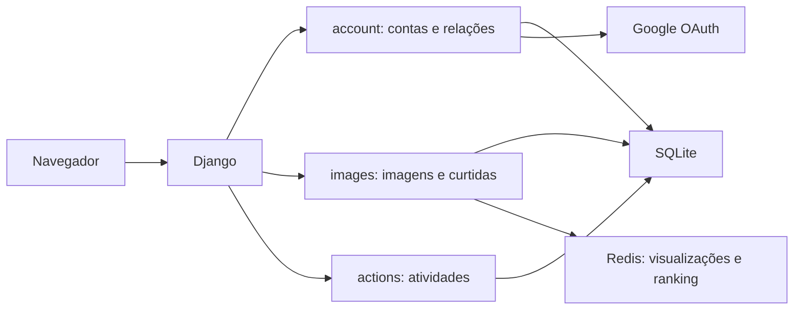

# Bookmarks — website social

Projeto de estudo dos capítulos 4 a 7 de **Django 5 By Example**, de Antonio Melé (Packt), seguindo os PDFs fornecidos. A aplicação salva e compartilha imagens da internet e permite acompanhar usuários e atividades.

## Origem e licença

Base oficial: https://github.com/PacktPublishing/Django-5-by-example/tree/main/Chapter07

Referência utilizada: commit `dc916b22936ebaddc0a1bdbb8964f9f3420a7354`.
Código da editora distribuído sob MIT; licença preservada em LICENSE. Os PDFs do livro não integram este repositório.

## Recursos

- Cadastro, autenticação por usuário ou e-mail, logout e recuperação de senha.
- Perfil com foto e data de nascimento; administração Django.
- Login Google por OAuth 2.0, mediante configuração própria.
- Captura de imagens por bookmarklet, miniaturas, curtidas e rolagem infinita.
- Seguir usuários, fluxo de atividades e contadores de curtidas.
- Visualizações e ranking com Redis; Django Debug Toolbar.

## Executar no Windows (PowerShell)

```powershell
python -m venv .venv
.\.venv\Scripts\python -m pip install -r requirements.txt
Copy-Item .env.example bookmarks/.env
.\.venv\Scripts\python bookmarks/manage.py migrate
.\.venv\Scripts\python bookmarks/manage.py createsuperuser
.\.venv\Scripts\python bookmarks/manage.py runserver
```

Abra http://127.0.0.1:8000/account/ . Não existe usuário ou senha predefinido.
O banco SQLite e arquivos de mídia são locais e não são versionados.
Use uma chave SECRET_KEY estável em bookmarks/.env para persistir sessões entre reinicializações; sem ela uma chave temporária é gerada a cada processo.

## Redis

As páginas de detalhes e ranking precisam de um Redis real, conforme o capítulo 7. Em um ambiente com Docker já instalado:

```powershell
docker run --name bookmarks-redis -p 127.0.0.1:6379:6379 -d redis:7
```

Este comando é uma instrução; o projeto não instala Docker nem inicia serviços globais automaticamente.

## HTTPS e Google

Para o bookmarklet funcionar em páginas HTTPS, execute o servidor HTTPS ensinado no capítulo 5:

```powershell
Set-Location bookmarks
..\.venv\Scripts\python manage.py runserver_plus --cert-file cert.crt
```

Configure um cliente OAuth no Google, a origem correspondente e o retorno `/social-auth/complete/google-oauth2/`. Preencha GOOGLE_OAUTH2_KEY e GOOGLE_OAUTH2_SECRET em bookmarks/.env. Nunca versione esses valores.
O bookmarklet aponta para 127.0.0.1:8000, como no exemplo oficial. Se mudar endereço ou porta, ajuste images/static/js/bookmarklet.js e o lançador.
A recuperação de senha imprime o e-mail no terminal, como no ambiente didático; envio real exige um provedor de e-mail.

## Validação

```powershell
.\.venv\Scripts\python bookmarks/manage.py check
.\.venv\Scripts\python bookmarks/manage.py test account
```

Os testes usam banco temporário. O teste da integração Redis simula o cliente e não substitui uma validação com serviço real.

## Arquitetura



## Ajustes em relação à referência

- Configurações sensíveis lidas do ambiente e credenciais OAuth opcionais na inicialização.
- Idioma do Django pt-BR e fuso America/Sao_Paulo; templates didáticos originais preservados.
- Corrigida referência indefinida a User nos formulários de e-mail.
- Autenticação por e-mail respeita contas desativadas.
- Testes de regressão para contas, permissões e interações sociais.

Este é o projeto didático dos capítulos. Publicar o código no GitHub não publica a aplicação em produção. As dependências históricas e o download de URLs externas exigem revisão adicional antes de uma implantação pública do serviço.

## Compatibilidade e resultado das verificações

Ambiente validado: Python 3.14.8, Django 5.2.19 e Pillow 11.3.0. easy-thumbnails foi atualizado de 2.8.5 para 2.10.1 porque a versão da referência importa get_storage_class, removido no Django 5.2. As versões resolvidas estão em requirements-lock.txt.

A relação following é adicionada dinamicamente ao usuário, conforme o livro. Por isso makemigrations global sugere uma migração auth; não gere migrações dentro do Django instalado. A tabela intermediária Contact já é criada pelas migrações de account.

Verificações: check sem problemas; migrações aplicadas; sete testes de regressão. Redis real, Google OAuth e navegação por bookmarklet em site externo ainda dependem dos serviços e configurações descritos acima.
